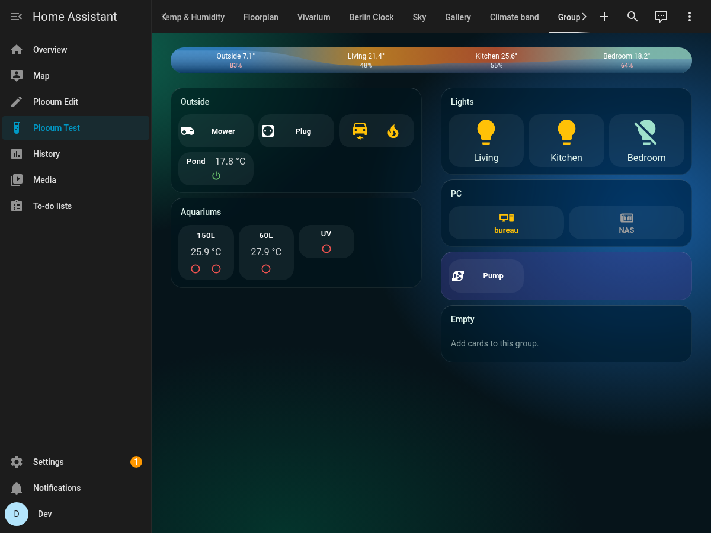

# HA Plooum Themes

[English](https://github.com/plooum/HA-Plooum-Themes/blob/main/README.md) | **Français**

[](https://github.com/hacs/default)
[](LICENSE)

Des thèmes Home Assistant pensés pour aller avec les [HA Plooum Cards](https://github.com/plooum/HA-Plooum-Cards), livrés comme **un seul thème HACS** : une installation, et tous les thèmes Plooum apparaissent dans la liste des thèmes de ton profil.

## Thèmes inclus

| Thème | Mode | Pensé pour |
| :--- | :--- | :--- |
| Plooum Lagon | Sombre | Groupes en verre dépoli (`ha-plooum-group-card`), bande climat |

### Plooum Lagon
Un thème sombre bleu canard et turquoise : des halos de couleur doux en fond (un dégradé CSS, aucune image à charger), des cartes translucides, et la couleur du verre dépoli de la carte groupe Plooum (`plooum-group-color`).



---

## Installation

### Méthode 1 : HACS (recommandée)
1. Ouvre **HACS** dans Home Assistant.
2. Clique sur les trois points en haut à droite > **Dépôts personnalisés**.
3. Ajoute l'URL de ce dépôt (`https://github.com/plooum/HA-Plooum-Themes`) et choisis la catégorie **Thème**.
4. Cherche `HA Plooum Themes`, puis clique sur **Télécharger**.

### Méthode 2 : à la main
Copie [themes/plooum.yaml](themes/plooum.yaml) dans le dossier `themes/` de ta configuration Home Assistant.

### Ensuite, dans les deux cas
1. Vérifie que les thèmes sont activés dans `configuration.yaml` (une seule fois) :
   ```yaml
   frontend:
     themes: !include_dir_merge_named themes
   ```
   Après l'ajout de cette ligne, redémarre Home Assistant. Pour les mises à jour suivantes, l'action **Recharger les thèmes** (`frontend.reload_themes`) suffit.
2. Choisis le thème dans ton profil (*Profil → Thème*), ou sur une seule vue avec `theme: Plooum Lagon` dans le YAML de la vue.
3. Le fond propre d'une vue (paramètres de la vue → **Arrière-plan**) passe par-dessus celui du thème : mets-le à « aucun » pour voir les halos du thème.

## Variables de thème pour les cartes Plooum

En plus des variables habituelles de Home Assistant, les thèmes Plooum règlent :

| Variable | Lue par | Effet |
| :--- | :--- | :--- |
| `plooum-group-color` | `ha-plooum-group-card` | Couleur du verre dépoli de chaque groupe (sauf si le groupe règle `glass_color`) |

## Développement

Tous les thèmes vivent dans le seul fichier [themes/plooum.yaml](themes/plooum.yaml) : HACS ne gère qu'un fichier de thème par dépôt, et un fichier YAML peut déclarer plusieurs thèmes. Pour tester une modification, copie le fichier dans le dossier `themes/` d'un Home Assistant (par exemple le Home Assistant de dev de HA-Plooum-Cards, `dev/ha-config/themes/`) et appelle `frontend.reload_themes`.

## Licence

[GPL-3.0](LICENSE)
