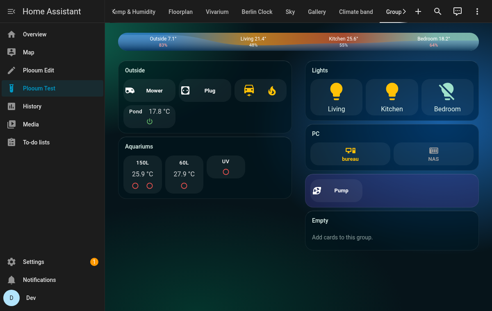
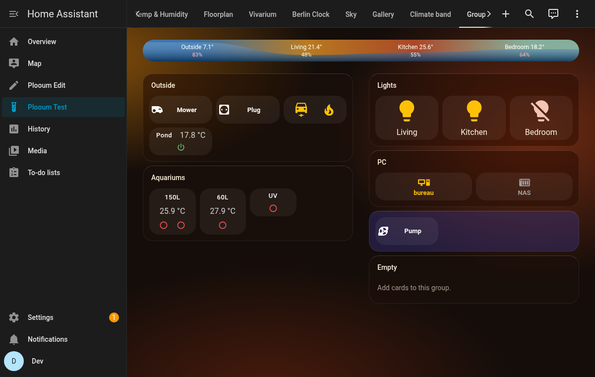
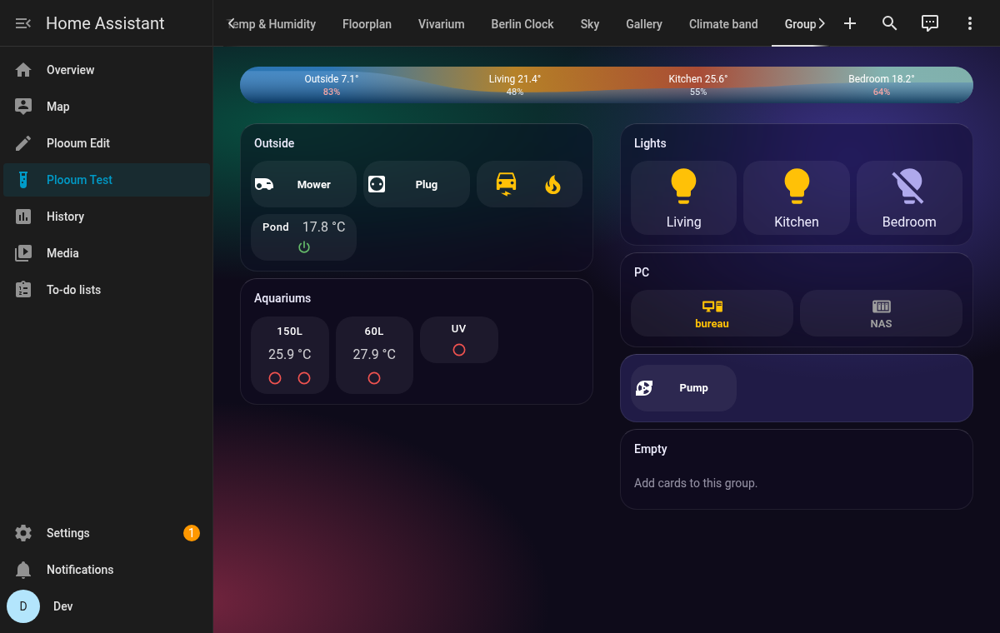
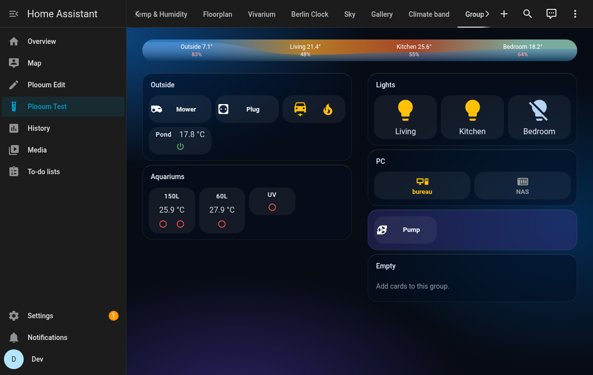

# HA Plooum Themes

**English** | [Français](https://github.com/plooum/HA-Plooum-Themes/blob/main/README.fr.md)

[](https://github.com/hacs/default)
[](LICENSE)

Home Assistant themes made to go with the [HA Plooum Cards](https://github.com/plooum/HA-Plooum-Cards), packaged as **a single HACS theme**: one install, and every Plooum theme shows up in your profile's theme list.

## Included themes

| Theme | Mode | Made for |
| :--- | :--- | :--- |
| Plooum Lagon | Dark | Frosted glass groups (`ha-plooum-group-card`), climate band |
| Plooum Braise | Dark | Evenings: warm charcoal, amber and coral |
| Plooum Boréale | Dark | The most colorful glass: violet night, sea green and magenta veils |
| Plooum Minuit | Dark | The most sober: deep ink blue, steel halos |

### Plooum Lagon
A dark teal and turquoise theme: soft colored halos as the background (a CSS gradient, no image to load), translucent cards, and the color of the frosted glass of the Plooum group card (`plooum-group-color`).



### Plooum Braise
A warm charcoal with amber and coral halos, like smouldering embers: the coziest, for the evening. Lit devices glow amber and coral.



### Plooum Boréale
A violet night crossed by sea green and magenta veils, like a northern light: the most colorful, where the frosted glass looks its best. Its accent is sea green.



### Plooum Minuit
A deep ink blue with cold steel halos: the most sober, nothing draws the eye away from the data. Its accent is sky blue.



---

## Installation

### Method 1: HACS (recommended)
1. Open **HACS** in Home Assistant.
2. Click the three dots in the top right corner > **Custom repositories**.
3. Add this repository's URL (`https://github.com/plooum/HA-Plooum-Themes`) and choose the **Theme** category.
4. Search for `HA Plooum Themes`, then click **Download**.

### Method 2: Manual
Copy [themes/plooum.yaml](themes/plooum.yaml) into the `themes/` folder of your Home Assistant configuration.

### Then, in both cases
1. Make sure themes are enabled in `configuration.yaml` (once):
   ```yaml
   frontend:
     themes: !include_dir_merge_named themes
   ```
   After adding this line, restart Home Assistant. For later updates, the **Reload themes** action (`frontend.reload_themes`) is enough.
2. Pick the theme in your profile (*Profile → Theme*), or on a single view with `theme: Plooum Lagon` (or any other Plooum theme) in the view's YAML.
3. A view's own background (view settings → **Background**) is drawn over the theme's: set it to none to see the theme's halos.

## Theme variables for the Plooum cards

Besides Home Assistant's usual variables, the Plooum themes set:

| Variable | Read by | Effect |
| :--- | :--- | :--- |
| `plooum-group-color` | `ha-plooum-group-card` | Color of the frosted glass of every group (unless the group sets `glass_color`) |

## Development

Every theme lives in the single file [themes/plooum.yaml](themes/plooum.yaml): HACS manages one theme file per repository, and one YAML file can declare several themes. To test a change, copy the file into a Home Assistant's `themes/` folder (for instance the development Home Assistant of HA-Plooum-Cards, `dev/ha-config/themes/`) and call `frontend.reload_themes`.

## License

[GPL-3.0](LICENSE)
